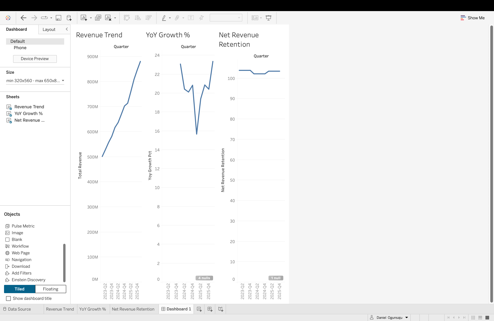

# HubSpot SaaS Metrics Dashboard

**SQL (MySQL) · Tableau** · real numbers from HubSpot's SEC filings - nothing simulated

**[Open the live dashboard on Tableau Public](https://public.tableau.com/app/profile/daniel.ogunsaju/viz/HubSpotSaaSMetricsDashboard/Dashboard1)**

## What it does

Tracks HubSpot's revenue growth, customer acquisition cost (CAC), and net revenue retention (NRR) from Q1 2023 to Q1 2026, using 9 of their 10-Q and 10-K filings.

## Results

- **Revenue grew about 20% a year, every quarter** - $2.17B (2023) -> $2.63B (2024) -> $3.13B (2025). The one dip was Q1 2025 (+15.7%), then back to +23.4% by Q1 2026
- **Customers: 167K -> 289K** from 2022 to 2025
- **NRR slowed, then recovered:** 110.3% (2022) -> 103.9% -> 102.2% -> 103.5% (2025)
- **CAC went up:** about $28,340 per new customer (2023) -> $28,446 (2024) -> $33,836 (2025) - each new customer got more expensive to win

## How it works

1. **Extract** - pulled revenue, subscription revenue, and sales & marketing spend from each filing by hand (raw files in `XLS/`)
2. **Load** (`01`) - 2 MySQL tables: quarterly financials (13 rows) and annual metrics (4 rows), each row tagged with its source filing
3. **Analyze** (`02`-`04`) - QoQ and YoY growth with `LAG()`, CAC with CTEs, growth + retention side by side
4. **View** (`05`) - one combined SQL view that Tableau connects to
5. **Check** (`06`) - row counts, no blanks, no missing quarters, subscription revenue never bigger than total

## Problems I hit and how I fixed them

| Problem | Fix |
|---|---|
| HubSpot doesn't report Q4 on its own - only the full year | Calculated Q4 = full year - Q1 - Q2 - Q3, checked it against their Q4 press release, and tagged those rows "derived" |
| Customer count and NRR are only reported once a year | Did CAC at the yearly level instead of quarterly |
| First CAC version lost 2022, so 2023 had nothing to compare to | The JOIN was removing 2022 before `LAG()` ran - fixed by running `LAG()` on the full table first, then joining |
| NRR was saved as text ("103.9%"), so it couldn't be charted or compared | Changed it to a number (103.90) |
| Junk files (Mac `.DS_Store`, a Tableau temp file) were uploaded | Removed them and added a `.gitignore` |

## Limitations

CAC is a rough estimate - it assumes all sales & marketing spend went to new customers, but some of it goes to keeping and growing existing ones. Customer count and NRR are yearly only, because that's how often HubSpot reports them.

## Run it

1. Run the files in `sql/` in MySQL, in order (`01` to `06`)
2. Open `Dashboard.twb` in Tableau

The raw SEC filing exports are in [`XLS/`](XLS/) (named by filing number) and the cleaned data is in [`data/`](data/). Every SQL file has notes explaining what each part does.
